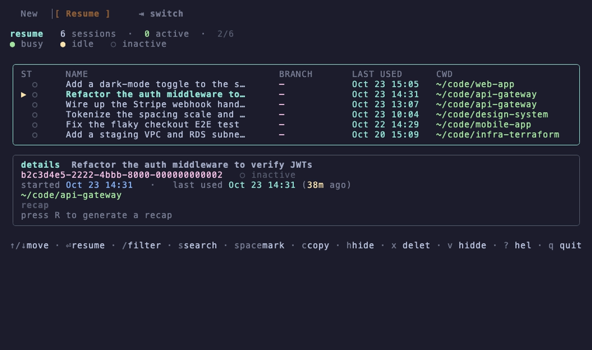
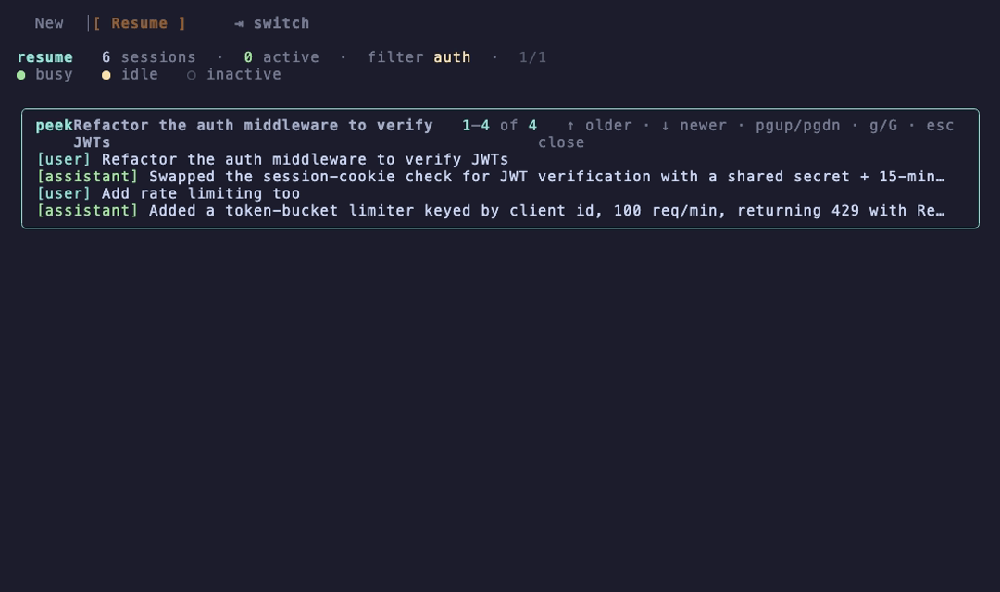

<div align="center">


# agentctl

### One menu for every Claude & Codex session — start a new one in any project, or search and resume an old one.

A fast launcher for coding-agent sessions: pick a project and start **`claude`** / **`codex`**, or
fuzzy-search and **resume** any past Claude Code session — with a live transcript preview. Runs in
your terminal as **`agentctl`**.

[](https://www.apple.com/macos/)
[](#install)
[](https://nodejs.org)
[](https://www.npmjs.com/package/@roypadina/agentctl)
[](https://github.com/roypadina/homebrew-tap)
[](https://github.com/roypadina/agentctl/releases/latest)
[](https://github.com/roypadina/agentctl/actions/workflows/ci.yml)
[](https://apps.roypadina.synology.me/apps/agentctl/)
[](LICENSE)
[](https://ko-fi.com/roypadina)
[](CONTRIBUTING.md)
[](https://github.com/roypadina/agentctl/stargazers)

</div>

---

## Table of Contents

- [Why](#why)
- [Features](#features)
- [Screenshots](#screenshots)
- [Install](#install)
- [The terminal menu](#the-terminal-menu)
- [Names, notes, flags and reminders](#names-notes-flags-and-reminders)
- [Several Claude accounts](#several-claude-accounts)
- [Configuration](#configuration)
- [How it works](#how-it-works)
- [Is it safe?](#is-it-safe)
- [Uninstall](#uninstall)
- [Contributing](#contributing)
- [Feature requests and contributions](#feature-requests-and-contributions)
- [Support](#support)
- [License](#license)

## Why

You start coding-agent sessions all day — `claude` here, `codex` there — and then you want to jump
back into one from yesterday but can't remember which folder it was in. Claude Code stores every
session under `~/.claude/`, but there's no good way to *find* one.

agentctl is two halves of that workflow in one tool:

- **New** — pick a project directory (grouped, frecency-sorted, fuzzy-filtered) and launch your agent
  there. Open it in your IDE first, in tmux, after a `git pull`, or create a brand-new directory on the fly.
- **Resume** — fuzzy-search every Claude Code session by name, path, or **full transcript text**, preview
  the conversation, and resume it in its original working directory.

It's **local-only** — it reads `~/.claude/` and your project folders, and runs no network calls of its own.

## Features

| | |
|---|---|
| 🆕 **New-session launcher** | Grouped project dirs, frecency-sorted (`z`, falls back to mtime), fuzzy filter, git branch per row. |
| 🔁 **Resume anything** | Every Claude Code session, fuzzy-matched on name / path / id — or full-text searched across transcripts. |
| 👀 **Transcript peek** | Preview a session's conversation before resuming — inline in the terminal. |
| 🧠 **AI recap** | `r` summarizes a session (what it was doing, decisions, state, follow-ups) via `claude -p` on haiku, cached. Decide whether to resume without reading the whole transcript. |
| ⌨️ **Two tabs, one keystroke** | Start in **New**; `⇥` flips to **Resume**; `⇧⇥` cycles the tool. |
| 🧰 **Your tools & IDEs** | Configure any agent command (`claude`, `codex`, …) and `^`-key IDE binds (VS Code, Rider, …). |
| 🪄 **tmux / pull / file manager / new-dir** | One-key open-in-tmux, `git pull` first, open the folder, or make a new directory anywhere. |
| 🏷️ **Names, notes, flags, reminders** | Rename any session (as often as you like), pin a note to it, tag it `todo`, mark it done, or set a reminder — from the picker, the CLI, or from inside the session itself. |
| 👥 **Every Claude profile** | Run several accounts via `CLAUDE_CONFIG_DIR`? All of their sessions show up, live status included — and resume runs under the right profile instead of silently using the wrong account. |
| 🗂️ **One config file** | Groups, tools and IDE binds live in one TOML file — `agentctl config --edit` opens it. |
| 🔐 **No cloud, no telemetry** | Reads local files only. No accounts, no analytics, no network calls of its own. |

## Screenshots

Resume: every session across your Claude profiles, with details for the highlighted one.



Peek at the conversation before you resume it:



(Rendered from a fake demo dataset: `bash docs/demo-fixture.sh && vhs docs/demo.tape`.)

## Install

> **Requirements:** Node 18 or later. Tested on macOS; Linux is best-effort (the same code runs, CI covers it, but it is not used daily). Windows is not supported.

### Homebrew (macOS)

```bash
brew install --cask roypadina/tap/agentctl
```

This puts **`agentctl`** on your `PATH`. Upgrading from 0.10 or older also removes the old
menu-bar app (`brew upgrade --cask agentctl`).

### npm (macOS and Linux)

```bash
npm i -g @roypadina/agentctl
```

### From source

```bash
git clone https://github.com/roypadina/agentctl.git
cd agentctl
npm install
npm run build
npm link            # puts agentctl on your PATH
```

First run sets up a starter config: `agentctl config --setup`.

## The terminal menu

`agentctl` opens the menu — **New** by default, `⇥` to **Resume** (or jump straight there with `-r`).

| Command | Opens |
|---|---|
| `agentctl` | New-session menu (`⇥` to Resume) |
| `agentctl -r` | Resume menu |

Plus non-interactive subcommands:

```bash
agentctl ls [--cwd <path>] [--active] [--json] [--sort updated|started|name] [--limit N]
agentctl peek <id> [--full] [--head N --tail N]   # print a transcript
agentctl recap <id> [--refresh]                   # AI summary of a session (cached)
agentctl resume <id> [--yes] [--cwd <override>]   # resume by id (prefix ≥ 4 chars)
agentctl ls --tool | --interactive                # only tool runs / only real sessions
agentctl path <id>                                # print the .jsonl path
agentctl config --setup | --edit | --path         # manage the shared config
```

### Keys

**New** — `↑/↓` move · type to fuzzy-filter · `↵` launch · `⇥` Resume · `⇧⇥` cycle tool · `^n` new dir ·
`^t` tmux · `^p` pull · `^f` file manager · `^`-key IDEs · `?` full keymap · `esc` back.

**Resume** — `↑/↓` (or `j/k`) move · `pgup/pgdn` page · `g/G` first/last · `↵` resume · `p` peek · `r` recap ·
`/` fuzzy-filter · `s` full-text search · `^r` refresh · `⇥` New · `?` help · `q` quit.
Annotate the highlighted session in place: `e` name · `n` note · `l` labels · `f` flags · `t` reminder ·
`u` due date · `d` done. `c` copies a resume command, `h` hides a session, `x` deletes it (twice),
`v` shows the hidden ones, `H` shows/hides done ones, `T` filters tool runs. (`l` pre-fills the issue
key from the branch.)

`space` marks sessions — `h`, `x` and `d` then act on every marked one at once, and the cursor stays
where it was instead of jumping back to the top.

`c` puts `agentctl resume <id>` on your clipboard — paste it in any other terminal to pick that
session back up, working directory and Claude profile included. Wide terminals also show a short
id column in the list.

Deleted sessions are deliberately **not reachable from the menu** — that is what makes deleting feel
safe to do. Recover them with `agentctl delete --undo`.
Highlighting a row shows its full details + recap inline. A `!` marks a session whose working directory
couldn't be decoded with confidence — `↵` twice to resume anyway.

### Tool runs vs. sessions you actually sat in

A `▸` marks a session something else started — `claude -p`, the SDK, an MCP client — rather than one you
typed into. It comes straight off the transcript's entrypoint, so it is known for dead sessions too.
`T` in the menu cycles **everything → interactive only → tool runs only**; the CLI has `agentctl ls --tool`
and `--interactive`.

One honest limit: a *real* interactive session that a script drove (tmux `send-keys` into a live
`claude`, say) is recorded by Claude Code as interactive, because that is exactly what it was. Only
headless and SDK entry points are distinguishable.

## Names, notes, flags and reminders

Sessions arrive named after your first prompt, which ages badly. Give them a real name — and everything
else you'd want to remember about them:

```bash
agentctl name  "billing spike"     # rename it; as many times as you like
agentctl note  "waiting on Dor"    # a note that shows under the row
agentctl flag  todo later          # tags; the picker's filter searches them
agentctl remind 2h                 # or 30m · 3d · tomorrow 9am · 17:00 · an ISO date
agentctl done                      # finished (--undo reopens); h hides done sessions
agentctl annotations               # everything you've annotated  (--due for what's come due)
```

Run inside a Claude session, they target **that** session — no id needed. From anywhere else, add
`-s <id-or-prefix>`. Rows show `✓` done, `⚑` flagged, `✎` noted, `◆` reminder, `✱` due date — red once overdue.
Labels and flags are both matched by the picker's filter, so `RD-12345` finds every session on that ticket.

It's stored in `~/.config/agentctl/annotations/<session-id>.json`, one small file per session,
deliberately outside `~/.claude` — nothing here can corrupt a transcript.

### From inside Claude Code

The [`agentctl-sessions` plugin](https://github.com/roypadina/padina-claude-code-plugins) gives Claude the whole toolset:

- **Slash commands** — `/agentctl-name`, `/agentctl-note`, `/agentctl-label`, `/agentctl-flag`,
  `/agentctl-remind`, `/agentctl-due`, `/agentctl-done`.
- **A `SessionStart` hook** that hands each session its own name, labels, note and due state back, so a
  resumed session knows what it is and what is overdue.
- **A skill** that teaches Claude to do it unprompted — name the session once the task is clear, label it
  with the issue key from your branch — and to drive every command when you just ask in plain words
  ("mark this done", "remind me in 2h", "what do I need to get back to?"). If `agentctl` isn't installed
  it offers to install it rather than failing quietly.

```
/plugin marketplace add roypadina/padina-claude-code-plugins
/plugin install agentctl-sessions@padina
```

## Several Claude accounts

Claude Code keeps each account in its own `CLAUDE_CONFIG_DIR` (`~/.claude`, `~/.claude2`, …). agentctl scans **all** of them, so every session is listed with the correct live status, and resuming pins
`CLAUDE_CONFIG_DIR` to the profile that session belongs to. To *start* new sessions on a given account,
add one tool per profile:

```toml
[[tool]]
name  = "work"
runs  = "CLAUDE_CONFIG_DIR=~/.claude2 claude --permission-mode auto"
label = " ⚡ Work account "
```

`⇧⇥` cycles between them. The same trick works for any tool and any env var — Codex profiles
included; `runs` is just a shell command.

**Resuming** picks the account automatically: a session running under a side profile is resumed
under it. For a session that has already exited, that information is not recorded anywhere — when
profiles share a `projects/` dir (which the usual setup symlinks), nothing on disk says which
account created it — so it falls back to your default. Override it with `a` in the menu or
`agentctl resume <id> --profile ricky@example.com`.

**If you have one Claude account — the normal case — none of this appears.** No account row, no
picker, no extra keys.

## Configuration

One TOML file:

```
$AGENTCTL_CONFIG  →  $XDG_CONFIG_HOME/agentctl/config.toml  →  ~/.config/agentctl/config.toml
```

`agentctl config --setup` writes a starter; `agentctl config --edit` opens it.
See [`config.example.toml`](config.example.toml) for every option. The shape:

```toml
default_tool = "claude"

[[group]]                       # a section in the New screen; `path` is scanned one level deep
name  = "Work"
path  = "~/code/work"
color = "#6C91BF"

[[tool]]                        # an agent launcher: `runs` is executed in the chosen dir
name  = "claude"
runs  = "claude --permission-mode auto"

[[ide]]                         # an fzf-style ^key that opens an editor, then the tool
key   = "ctrl-v"
label = "code"
cmd   = 'code "$dir"'
```

## How it works

A clean two-layer split keeps the logic reusable and testable:

| Layer | Role |
|---|---|
| **`src/core/`** | Pure data — zero React/ink. Session scan & cwd-decode, streaming JSONL parse, live-PID status, git branch, fuzzy matcher, TOML config, project scanner, launch planner. Unit-tested. |
| **`src/cli/`** | The ink TUI (New + Resume tabs, peek, search) and the non-interactive subcommands. The only layer that touches presentation. |

Session names come from the transcript in priority order: a `/rename` custom title → an auto-generated
title → the first user prompt. Status (`busy`/`idle`/`inactive`) is derived from a live PID file plus a
`kill -0` / `ps` check. Working directories are decoded from Claude Code's ambiguous `-`-encoded folder
names by walking the filesystem — and flagged when the result isn't certain.

📖 Full docs are in the **[Wiki](https://github.com/roypadina/agentctl/wiki)** (Installation · Commands · Configuration · Architecture · FAQ). See [`CLAUDE.md`](CLAUDE.md) for the contributor module map.

## Is it safe?

- **Open source (MIT).** Read or build every line yourself.
- **Local-only. No network calls of its own, no analytics, no accounts.** It reads `~/.claude/` and the
  project folders you configure, and launches your terminal. That's it.
- **Permissions.** Claude sessions start and resume in Claude Code's **auto** permission mode
  (`--permission-mode auto`). To opt into bypass, set `permission_mode = "bypassPermissions"` at the top of
  your config (adds `--dangerously-skip-permissions` to Resume and the built-in `claude` tool). The default
  Codex tool still uses Codex's sandbox-bypass flag; change its `runs` to drop it.

## Uninstall

```bash
brew uninstall --cask agentctl        # if installed via Homebrew
# npm uninstall -g @roypadina/agentctl   # if installed from npm
# or: npm unlink -g agentctl          # if installed from source via npm link

rm -rf ~/.config/agentctl             # forget config (optional)
```

## Contributing

PRs welcome! `main` is protected — fork, branch, add tests, and open a PR. See
[CONTRIBUTING.md](CONTRIBUTING.md) and the [Code of Conduct](CODE_OF_CONDUCT.md).

```bash
npm test && npm run typecheck && npm run build   # the whole check
```

## Feature requests and contributions

Have an idea for Agentctl? [Request a feature](https://github.com/roypadina/Agentctl/issues/new?template=feature_request.yml) and say what you're trying to do; that matters more than the exact feature. Found a bug? [Report it](https://github.com/roypadina/Agentctl/issues/new?template=bug_report.yml).

See [CONTRIBUTING.md](CONTRIBUTING.md).

Tipped on [Ko-fi](https://ko-fi.com/roypadina)? Add your Ko-fi name to the request and it goes to the front of my queue. It's a thank-you, not a purchase: no promise on what ships or when.

## More Mac apps by Roy

Free, open-source Mac menu-bar apps and terminal tools, all on one site: **[apps.roypadina.synology.me](https://apps.roypadina.synology.me/)**.

- [Agents Monitor](https://apps.roypadina.synology.me/apps/agents-monitor/) — See your Claude Code and Codex usage limits before you hit them.
- [AgentsSessionHopper](https://apps.roypadina.synology.me/apps/agents-session-hopper/) — Profiles for Claude Code. One conversation, any of your accounts.
- [claude-jam](https://apps.roypadina.synology.me/apps/claude-jam/) — Share one real Claude Code session with other humans.

## Support

If agentctl saves you clicks and tab-hunting, you can support its development — it's optional and always appreciated.

[](https://ko-fi.com/roypadina)

A ⭐ on the repo helps just as much.

## License

[MIT](LICENSE) © Roy Padina · [Support on Ko-fi ☕](https://ko-fi.com/roypadina)
